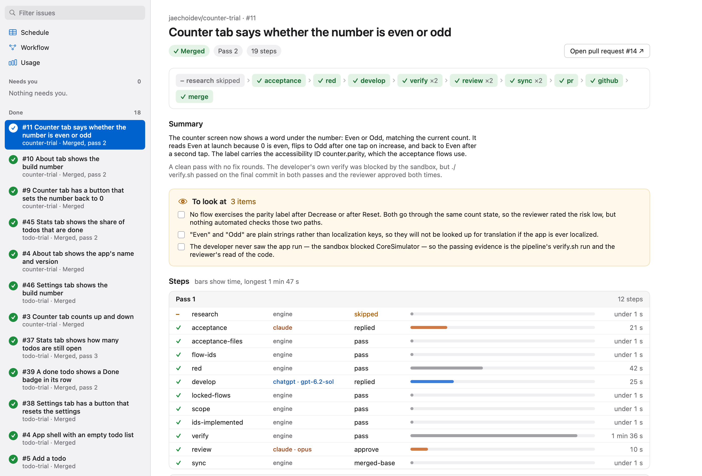

# Findings: the app, redrawn to the design canvas (2026-11-24)

The app had grown pane by pane: a list, a detail view and a row of tabs. A design canvas ("Factory macOS app, redesign") drew it again as four screens. This builds those four screens.

## Result

| Screen | Built from the canvas | Checked |
| --- | --- | --- |
| Issue window | Sidebar with marks, the strip of workflow steps, summary, a "to look at" list that can be ticked, steps by pass with time bars, the output folded away | Drawn from a real issue |
| Schedule | Places as squares, a card per project, pools as slot tiles, a plan card per provider with bars | Drawn idle from the real engine, and busy from a made-up state |
| Workflow and usage | The graph with dashed red return lines, the four limit cards, the usage table with bars | Drawn from a real workflow |
| Edit workflow | The bar with the problem count, the graph with refused steps, numbered lines with the engine's word under a bad line, the inspector | Drawn from a real workflow file with a wrong module name |

The app has 14 tests. The real window was looked at once, on the Usage screen: the toolbar, the sidebar and the screen are there. No other screen was clicked through in the real window.

## Where the app differs from the canvas

- **The toolbar is the system's.** The canvas draws its own bar with the traffic lights. In a real window that is the title bar, so the project picker, the engine's status and the refresh button are toolbar items.
- **Workflow and Usage are two screens.** The canvas has both sidebar entries open one artboard. Here each opens its own part.
- **The editor is a plain text view while you type.** Line numbers, colored keys and the message under a bad line are drawn only when the editor is drawn to an image. A live text view with a gutter is its own piece of work. While typing, the problems are in the inspector with their line numbers.
- **A refused draft shows the last accepted graph.** The engine returns no graph for a draft it refuses. The canvas shows one with the refused steps marked, so the app keeps the last graph the engine accepted and marks the steps the problems name.
- **The sidebar's second line says more.** The canvas has "verify, pass 2". The app keeps its own wording, "Running verify, pass 2".
- **Light only.** The canvas is drawn light. The app no longer follows the system's dark setting.

## What is new beyond the look

- **A project picker.** It narrows the sidebar and the schedule to one repository and decides whose workflow is shown.
- **A filter** over number, title, key, repository and step.
- **"To look at" can be ticked.** Which items you ticked is kept on this machine, in the app's own settings. The engine does not know.
- **A mark per state,** including one for an issue the scheduler has parked, which the list could not tell from waiting before.
- **Quota bars.** The engine sends each window as a sentence. The app reads the percent out of it for the bar. A line it can't read is shown as text.

## Problems hit

1. **A module was "in use" that was not.** A draft that names `check/verifyy` also contains the text `check/verify`. The check now asks for the exact name.
2. **Long items were cut to one line** when drawn to an image. Text in a row now takes the height it needs.
3. **Lazy grids and scroll views draw nothing to an image.** The cards use a small layout of their own, and the graph scrolls sideways only in a window.
4. **Screen capture is not allowed from this shell,** so the real window could not be captured by a command. It was looked at through the desktop control the app's owner approved.

## Open items

- **Nobody has clicked through the real window.** Filter, picker, ticking an item, opening the editor and the two buttons of a stuck issue are untested by hand.
- **The canvas was still changing** while this was built: the Schedule artboard arrived during the day. This follows the version read at 05:30 UTC on 2026-11-25.
- **The editor's gutter while typing.**
- **Dark mode.**
- **Narrow windows.** The canvas says menus stack at phone width. The app has a minimum width of 1040 points instead.
