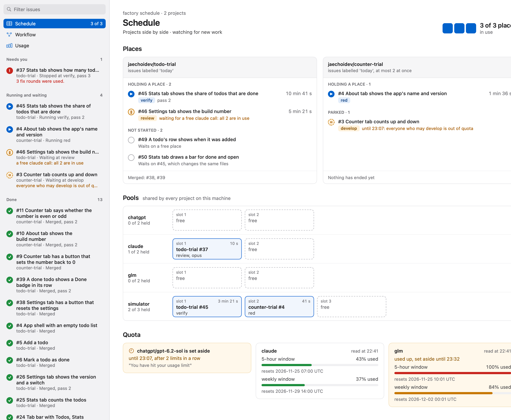
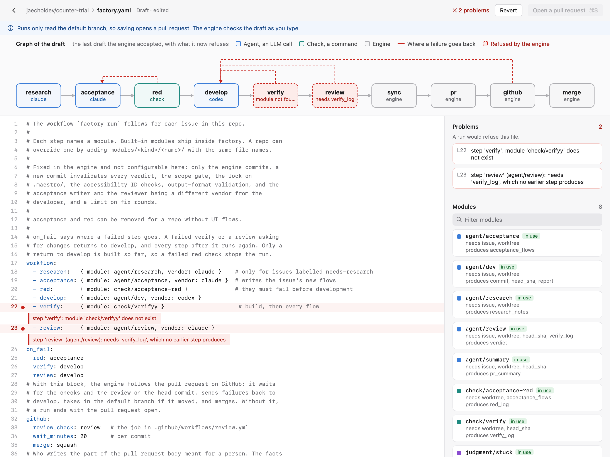

# Findings: the app, redrawn to the design canvas (2026-11-24)

The app had grown pane by pane: a list, a detail view and a row of tabs. A design canvas ("Factory macOS app, redesign") drew it again as four screens. This builds those four screens.

## Result

| Screen | Built from the canvas | Checked |
| --- | --- | --- |
| Issue window | Sidebar with marks, the strip of workflow steps, summary, a "to look at" list that can be ticked, steps by pass with time bars, the output folded away | Drawn from a real issue |
| Schedule | Places as squares, a card per project, pools as slot tiles, a plan card per provider with bars | Drawn idle from the real engine, and busy from a made-up state |
| Workflow and usage | The graph with dashed red return lines, the four limit cards, the usage table with bars | Drawn from a real workflow |
| Edit workflow | The bar with the problem count, the graph with refused steps, numbered lines with the engine's word under a bad line, the inspector | Drawn from a real workflow file with a wrong module name |

The app has 15 tests. The real window was then gone through control by control: see "The real window, by hand" below. The project picker is the one control that could not be tried.

## The real window, by hand

Every control was pressed in the running app through the system's accessibility, with the app in the background. The stuck issue's two buttons were pressed against a scratch engine with a made-up stuck issue and no checkout, so that they could reach the API without touching GitHub.

| Control | What happened |
| --- | --- |
| Filter | "counter" left the five counter-trial issues, "#46" left one |
| An issue in the sidebar | Opened its screen |
| A "to look at" item | Ticked, and stayed ticked. Not on the first try: see the problems |
| Latest output | Unfolded |
| Workflow, then "Edit workflow…" | The editor opened with the file, its graph, no problems and eight modules |
| Typing a draft with a wrong module name | Two problems with their line numbers, the two steps marked on the graph, "Open a pull request" off |
| "Add" on a module | A step line was added to the draft, and the module showed as in use |
| Revert, then back | The file was as on the default branch again, then the Workflow screen |
| Refresh beside Quota | All three plans were read again within twelve seconds |
| "Start over" and "Take off the queue" | Each reached the API, which refused for lack of a checkout, and the app said so |
| Stopping the engine | A red banner and a red dot in the toolbar within seconds |
| Project picker | Not tried. A menu can't be opened in a background window, and the test did not take the screen |

"Open a pull request" and "Scaffold as a pull request" were not pressed on purpose: each opens a real pull request.

What this turned up, all fixed:

1. **Ticking did nothing.** The "to look at" rows, the output's fold, the schedule's rows and the module kind were still shapes with a tap handler. They are real buttons now, like the rest.
2. **A draft was judged on another draft's word.** For half a second after an edit the editor still showed the last text's verdict. A broken draft read "No problems" with "Open a pull request" on, and a reverted one still listed the old problems. The verdict is now put away the moment the text changes, an answer about a text that has since changed is dropped, and the file as it is on the default branch needs no asking.
3. **A stuck step looked like it was running.** The strip marked the step a stopped issue is at with the mark for "at work". It is marked as failed now.
4. **The banner named a flag that is no longer needed.** It said to start the engine with `--repo-dir`. The engine serves the registered projects by itself.

## Where the app differs from the canvas

- **The toolbar is the system's.** The canvas draws its own bar with the traffic lights. In a real window that is the title bar, so the project picker, the engine's status and the refresh button are toolbar items.
- **Workflow and Usage are two screens.** The canvas has both sidebar entries open one artboard. Here each opens its own part.
- **The editor is a plain text view while you type.** Line numbers, colored keys and the message under a bad line are drawn only when the editor is drawn to an image. A live text view with a gutter is its own piece of work. While typing, the problems are in the inspector with their line numbers.
- **A refused draft shows the last accepted graph.** The engine returns no graph for a draft it refuses. The canvas shows one with the refused steps marked, so the app keeps the last graph the engine accepted and marks the steps the problems name.
- **The sidebar's second line says more.** The canvas has "verify, pass 2". The app keeps its own wording, "Running verify, pass 2".
- **Light only.** The canvas is drawn light. The app no longer follows the system's dark setting.

## What is new beyond the look

- **A project picker.** It narrows the sidebar and the schedule to one repository and decides whose workflow is shown.
- **A filter** over number, title, key, repository and step.
- **"To look at" can be ticked.** Which items you ticked is kept on this machine, in the app's own settings. The engine does not know.
- **A mark per state,** including one for an issue the scheduler has parked, which the list could not tell from waiting before.
- **Quota bars.** The engine sends each window as a sentence. The app reads the percent out of it for the bar. A line it can't read is shown as text.

## Problems hit

1. **A module was "in use" that was not.** A draft that names `check/verifyy` also contains the text `check/verify`. The check now asks for the exact name.
2. **Long items were cut to one line** when drawn to an image. Text in a row now takes the height it needs.
3. **Lazy grids and scroll views draw nothing to an image.** The cards use a small layout of their own, and the graph scrolls sideways only in a window.
4. **A drawn button did not answer a press.** The first controls were shapes with a tap handler, so that they would draw to an image. Pressed through the system's accessibility, the refresh button did nothing. Every control that acts is now a real button with a plain style, which draws the same and answers a click, the keyboard and an assistive press.
5. **Screen capture is not allowed from this shell,** so the real window could not be captured by a command. It was looked at through the desktop control the app's owner approved.

## Open items

- **The project picker is untried by hand.** Its logic is tested. The menu itself was never opened.
- **"Add" can name a step twice.** Adding `check/verify` to a draft that already has a step called `verify` adds another `verify`. The engine then reports it. The app could pick a free name.
- **"Take off the queue" asks nothing first.** It closes the pull request and deletes the branch at one press.
- **A notice stays until the next one.** "Could not retry" was still on screen after the following press.
- **Usage no longer follows the canvas.** At the owner's word it shows calls as a number and tokens with a bar, and no time. The plan cards and their refresh button moved there from Schedule too: what a plan has left and what was spent are one subject, and Schedule is about what runs now. Schedule keeps a "Set aside" section, shown only while someone is set aside, because that explains a wait. The canvas still draws time in Usage and Quota on Schedule.
- **The canvas was still changing** while this was built: the Schedule artboard arrived during the day. This follows the version read at 05:30 UTC on 2026-11-25.
- **The editor's gutter while typing.**
- **Dark mode.**
- **Narrow windows.** The canvas says menus stack at phone width. The app has a minimum width of 1040 points instead.
