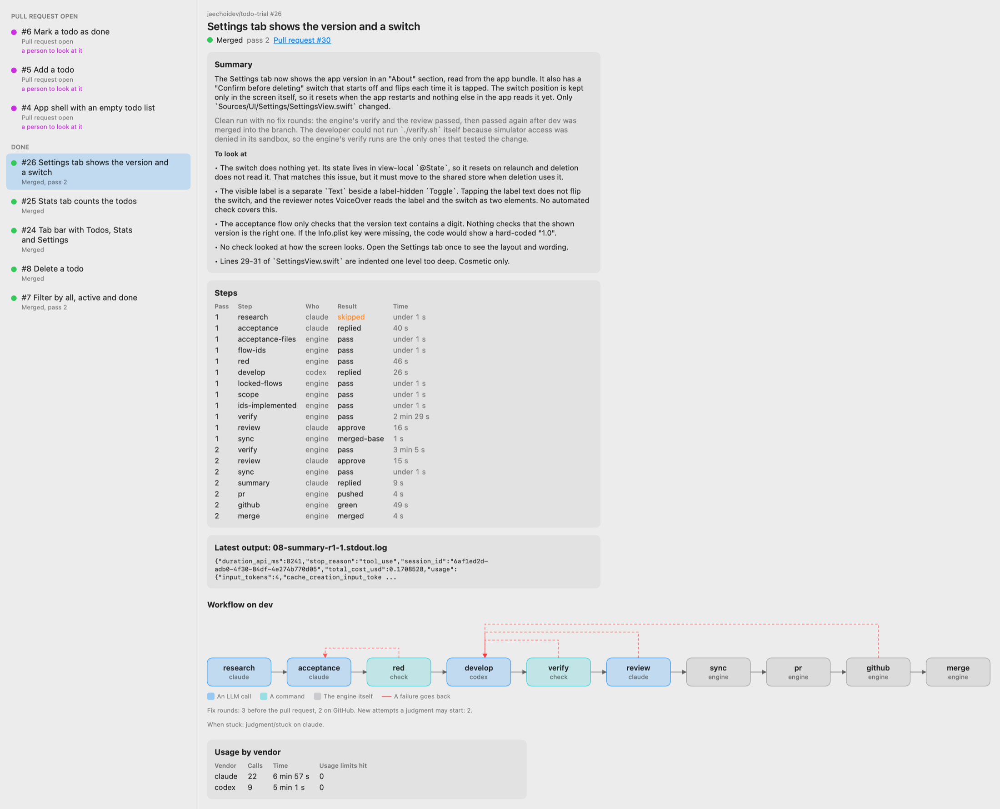

# Findings: the macOS app and the local API (2026-11-24)

Build-order step 9: the SwiftUI app with status, logs, the judgment queue and a read-only workflow graph.

## Result

| Part | What it is | How it was checked |
| --- | --- | --- |
| `factory serve` | A local HTTP API under `/v1`: issues, one issue with its steps, the newest output, the blocked list, the workflow graph, usage, and the retry and drop commands | Unit tests, and every route called against the day's real state while an issue was running |
| `app/` | A SwiftUI app: issue list, issue detail, a "Needs you" card with two buttons, the workflow graph, usage, a menu bar item | It builds, 6 tests pass, its panes were drawn to an image from live data, and it was launched once |

The image check used real data: issue #24 of the trial repository, mid-run, with its summary, its 13 steps and the trial repository's workflow graph.

## What the image check found

- **The "Latest output" card showed a wall of JSON.** The newest file of the run was an agent's raw reply, which is one line several thousand characters long. The app now cuts long lines, and the API prefers an agent's readable stderr over its stdout.
- **The pull request link drew as a yellow placeholder.** A SwiftUI `Link` can't be drawn to an image. It is now plain text that opens the page when clicked.
- **Three issues show "Pull request open" that are merged.** They were merged by hand before the engine could merge, so the database never learned. The app shows what the engine knows.

## Where the build differs from the design doc

- **`serve` is a separate command, not a daemon that also runs the loop.** The doc's engine is one process under launchd that runs issues and serves the API. Here runs are started by `factory queue` or `factory run`, and `serve` reads the same database. They meet in the database and the lock files.
- **No event stream.** The doc asks for server-sent events or a WebSocket so no client has to poll. The app asks again every two seconds.
- **A small synchronous HTTP server, not axum on tokio.** The API's work is reading SQLite and files. One request at a time is enough for one person's app.
- **No live log stream.** The app shows the end of the newest output file, refreshed with everything else.
- **No queue controls.** The doc lists start, pause, add and reorder. The app has retry and drop for stuck issues and nothing for the queue itself.
- **The workflow graph is drawn in a row.** It shows the steps in order and each failure's way back. It is not yet a general graph editor's canvas.

## What holds from the doc

- **One API, many clients.** The app has no path of its own. Its two buttons call the routes that run `factory retry` and `factory drop`.
- **Local by default, token required elsewhere.** The server refuses a non-local address without a token.
- **Versioned routes** under `/v1`.
- **No UI logic in the engine.** The engine says an issue's state is `needs-a-person`. The app decides that is red and goes first.
- **Not sandboxed.** The bundle from `build-app.sh` is signed ad hoc, for personal use.

## Open items

- **The app has not been used by a person.** It was launched for five seconds and drawn to an image. Nobody has clicked through it.
- **"Start over" and "Take off the queue" have not been clicked.** The routes behind them are tested only for unknown issues. The commands they run are tested.
- **Notifications are untested.** They need the app bundle and a person's permission.
- **The API has no tests over a real socket.** Its routing is tested as a function. The server loop was exercised by hand with `curl`.
- **A token is compared as plain text and sent over plain HTTP.** Fine on localhost. A network address needs TLS in front, which the doc also says.
