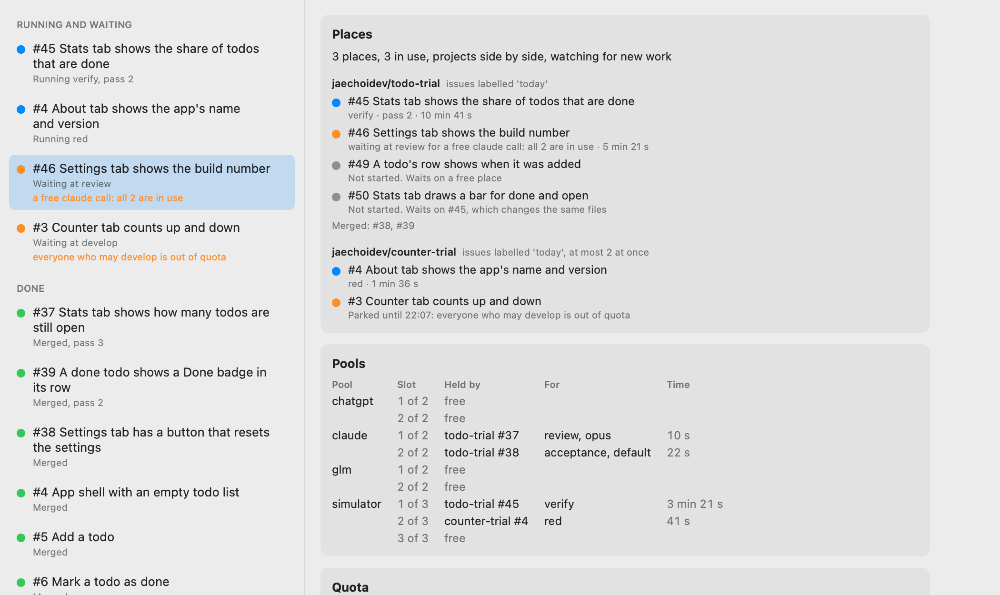

# Findings: a view of the scheduler (2026-11-24)

During the first two-project run the question was "can I see the status somewhere?", and the honest answer was three log files. The app listed issues. It did not show the places, the pools or who was out of quota. This adds that.

## Result

| | |
| --- | --- |
| Built | A board each scheduler writes, a note next to each held slot, the model kept with each step, `GET /v1/schedule`, and a Schedule pane in the app |
| Tested with stand-ins | 117 unit tests and 53 scenarios in the engine, 10 tests in the app. Four scenarios read the board or the notes while a run is going |
| Run for real | A real `factory schedule --watch` over both trial repositories with nothing labelled, read through the real `serve` and drawn by the app. Then the scheduler was stopped, and its board was no longer shown |
| Not run for real | A real issue on the board. No new issue existed to run. The picture below is drawn from a made-up state |

## What it shows

The picture is not a real run. It is the app drawing a scratch copy of the day's database with four issues set back to "running", a hand-written board, four hand-written notes and a hand-written quota file. It checks the drawing, not the engine.

- **Places.** How many, how many in use, and how the projects share them. Under each project: the issues that hold a place with their step and for how long, the issues that have not started with what each waits on, and the parked ones with their time.
- **Pools.** Every slot of every pool: free, or which issue holds it, for which step, for how long. An agent call names its model.
- **Quota.** Who is set aside after a usage limit and until when, and Z.ai's reading with the time it was read.
- **Who answered,** in an issue's step list: the provider and the model, such as `glm · haiku`.

## How it works

The scheduler and `factory serve` are separate processes. They met only in the database, which has no row for an issue that has not started and no idea of a place. So the scheduler now writes down what it decided.

- **The board** is `~/.factory/schedulers/<pid>.json`, written whole (a partial file, then a rename) after every start, end and parking. One file per scheduler, so `factory queue` on two repositories at once shows as two.
- **A slot's note** is a file next to the lock, written by the run that took the slot and removed when it lets go.
- **Neither file decides anything.** The lock holds the slot, and the scheduler's memory holds the places. A reader that sees a stale file shows something wrong for a moment and breaks nothing.
- **Liveness is the process.** A board or note whose process is gone is ignored. The API asks the system whether the process exists, and takes no lock to find out.
- **The API joins.** For an issue that holds a place, the board says since when and the database says which step it is at and what it waits on inside its place.

## What was decided against

- **Asking the lock whether it is held.** The API could try each slot's lock and see whether it gets it. For the instant it held one, a run looking for a free slot would see it taken, print "waiting for a free simulator" and take another. A viewer must not change what it views.
- **One scheduler-wide lock for liveness.** It would also have forbidden two queues at once, which is allowed today.
- **Keeping the last board after the scheduler ends.** What ended is in the issue list already.

## Problems hit

1. **Two issues were both "#4".** The first picture from real data showed `#4 About tab` and `#4 App shell` in one list, from two repositories. A row now says which repository it is in when the list holds more than one, and so does the menu bar.
2. **Three scenarios failed, and it was the way I ran them.** They use a hook that cuts a run off at a chosen step, which exists only in debug builds. `cargo test --release` leaves it out. `cargo test` passes all 53.
3. **A scenario assumed three merges by the last verify.** With one simulator the last verify starts before the one ahead has merged. The check now asks for what is always true.

## Open items

- **A real issue on the board.** The route was read for real with an idle scheduler only. The next real run is the check.
- **Steps from before today have no model.** The request log has it, and nothing copies it back.
- **The model is the name the engine started the program with.** For GLM that is `haiku`, which the env file maps to `glm-5.3-flash`. The pane shows the first.
- **A process id can be reused.** A stale note whose number now belongs to another process of this user would be shown until the slot is taken again. Not seen.
- **Still polling.** The app asks every two seconds. There is no event stream.
- **Nothing can be done from the pane.** It shows. Start, pause and reorder are still the command line's.
- **Times mix zones.** The app shows this machine's clock. Z.ai's reset times are printed by the engine in UTC.
