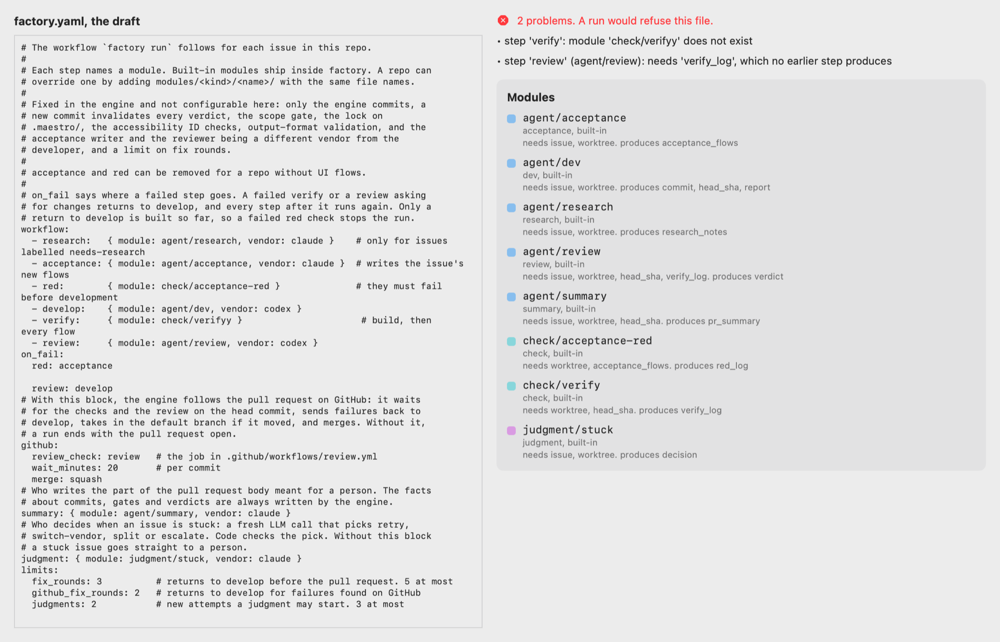

# Findings: workflow editing and module scaffolding (2026-11-24)

Build-order step 10: workflow editing and module scaffolding in the app. The doc's other half of this step, a web client, is for when the engine moves to a server, and is not built.

## Result

| Part | What it does | How it was checked |
| --- | --- | --- |
| Stricter workflow checks | Every check and review needs an `on_fail`, and it must point at an earlier step | Unit tests |
| `factory workflow validate` and `propose` | Checks a workflow file, and opens a pull request for a valid one | Engine scenarios, and one real pull request on the trial repository |
| `factory module list` and `new` | Lists what a workflow may name, and scaffolds a new module into a pull request | Unit tests, an engine scenario, and one real pull request |
| API routes | The same four things for the app | Called with `curl` against the trial repository |
| The app's editor | The file's text, checked as it is typed, with the draft's graph, the module list and a scaffold form | It builds, 8 tests pass, and its panes were drawn for a valid and a broken draft |

122 Rust tests and 8 Swift tests pass.

On the trial repository, through the API:

| Asked | Answer |
| --- | --- |
| Check a draft with a misspelled module | Not valid, with two problems: the module does not exist, and the review's need is no longer produced |
| Propose that draft | Refused with the same two problems. No pull request |
| Propose a draft with one limit changed | [todo-trial#31](https://github.com/jaechoidev/todo-trial/pull/31), changing only `factory.yaml` |
| Scaffold `check/lint` | [todo-trial#32](https://github.com/jaechoidev/todo-trial/pull/32), with `module.yaml` and an executable `run.sh` that fails until written |

Both pull requests were closed afterwards. They were trials, not changes to keep.

## Where the build differs from the design doc

- **The editor edits text, not a graph.** The doc calls a visual editor a project of its own. Here the file's text is edited, the engine checks it after every pause in typing, and the graph of the draft is drawn beside it. Comments in the file survive, which they would not if the app rewrote the file from a model.
- **Saving is a pull request.** The doc says the engine checks a workflow before it is saved. A run reads its workflow from the default branch so that it only ever uses reviewed files, so the app can't write there. It proposes, and a person merges.
- **A scaffolded module arrives as a pull request too,** not as a folder dropped into a checkout.
- **A scaffolded check fails on purpose** until someone writes it.
- **Gate modules are not scaffolded.** The doc lists `gate` as a kind. The engine's gates are fixed code, and a workflow file can't add one.
- **No web client.** The doc ties it to the engine moving to a server.

## Problems hit

1. **One mistake hid the others.** The checks on roles and vendors only ran when nothing else was wrong, so a draft with a missing `on_fail` and a wrong vendor reported only the first. For an editor that is the wrong way round. They now run whenever every step could be read.
2. **The new rule broke an older test's workflow,** which had a check with no `on_fail`. The rule was right and the test's file was changed.

## Open items

- **Nobody has typed in the editor.** Its panes were drawn from live data, and its two buttons call routes that were exercised with `curl`. The text field itself can't be drawn to an image.
- **"Add as a step" is simple text insertion.** It adds a line to the step list and, for a check, an `on_fail` line. It does not place the step where its needs are met. The engine's check then says what is wrong.
- **A scaffolded agent module is a copy.** Nothing explains to its author which placeholders the engine fills in a prompt.
- **A proposal is not checked again when it is merged.** If the default branch's modules change between the proposal and the merge, an invalid workflow could land. The next run would refuse it and say why.
